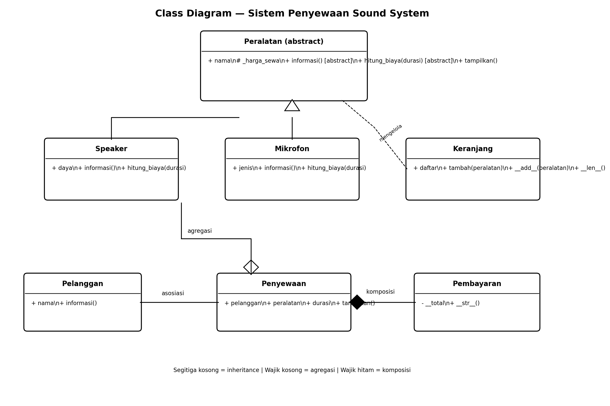

# Sistem Manajemen Penyewaan Peralatan Sound System untuk Acara di Kota Samarinda

## Deskripsi Program
Program ini merupakan aplikasi sederhana berbasis Python untuk menggambarkan proses penyewaan peralatan sound system. Program memiliki kelas pelanggan, peralatan, penyewaan, pembayaran, dan keranjang peralatan. Contoh peralatan yang digunakan adalah speaker dan mikrofon.

## Cara Menjalankan
1. Pastikan Python 3 sudah terpasang.
2. Buka terminal pada folder project.
3. Jalankan perintah:

```bash
python main.py
```

## Class Diagram



### Penjelasan Relasi UML

1. **Asosiasi — `Penyewaan` dengan `Pelanggan`**  
   Kelas `Penyewaan` menerima objek `Pelanggan` yang dibuat secara terpisah. Objek pelanggan digunakan untuk menampilkan informasi pelanggan pada transaksi penyewaan.

2. **Agregasi — `Penyewaan` dengan `Peralatan`**  
   Objek `Speaker` dan `Mikrofon` dibuat di luar kelas `Penyewaan`, kemudian diberikan sebagai daftar peralatan. Peralatan masih dapat digunakan atau dirujuk secara terpisah dari satu objek penyewaan. Pada diagram, agregasi ditandai dengan wajik kosong di sisi `Penyewaan`.

3. **Komposisi — `Penyewaan` dengan `Pembayaran`**  
   Kelas `Penyewaan` membuat objek `Pembayaran` di dalam konstruktor dan menyimpannya sebagai bagian internal penyewaan. Desain ini menunjukkan kepemilikan pembayaran oleh satu penyewaan. Pada diagram, komposisi ditandai dengan wajik terisi di sisi `Penyewaan`. Python tidak otomatis menghapus objek pembayaran ketika penyewaan dihapus; komposisi di sini merupakan keputusan desain dan kepemilikan objek.

## Penerapan Abstraksi
- `Peralatan` adalah abstract base class yang mewarisi `ABC`.
- `informasi()` dan `hitung_biaya(durasi)` adalah abstract method.
- `Speaker` dan `Mikrofon` mengimplementasikan kedua abstract method tersebut.
- `tampilkan()` adalah method konkret yang dapat digunakan bersama oleh subclass.
- Program mencoba membuat objek `Peralatan` secara langsung. Python menghasilkan `TypeError` karena abstract method belum diimplementasikan. Bagian ini ditampilkan pada output dengan judul `BUKTI ABSTRAKSI`.

## Penerapan Polimorfisme

### 1. Polimorfisme melalui Pewarisan
`Speaker` dan `Mikrofon` meng-override method `informasi()` dan `hitung_biaya()`. Keduanya dipanggil melalui satu loop pada daftar `daftar_peralatan`, sehingga setiap objek memberikan perilaku sesuai kelasnya.

### 2. Duck Typing
Fungsi `tampilkan_informasi(objek)` memanggil method `informasi()`. Fungsi tersebut digunakan untuk objek `Pelanggan` dan `Speaker`, yang tidak memiliki hubungan pewarisan satu sama lain. Fungsi tidak memeriksa tipe objek.

### 3. Operator Overloading
Kelas `Keranjang` mengimplementasikan `__add__()` agar operator `+` dapat menambahkan peralatan, serta `__len__()` agar `len(keranjang)` mengembalikan jumlah peralatan. Kelas `Pembayaran` mengimplementasikan `__str__()` agar objek pembayaran dapat ditampilkan sebagai teks.

## Inheritance dan Enkapsulasi
- `Speaker` dan `Mikrofon` memanggil `super().__init__(nama, harga_sewa)` untuk menggunakan inisialisasi dari `Peralatan`.
- Atribut `_harga_sewa` menggunakan konvensi protected.
- Atribut `__total` dan `__pembayaran` menggunakan name mangling untuk membatasi akses langsung dari luar kelas.

## Bukti Output Program
Jalankan `python main.py` dan ambil screenshot terminal yang menunjukkan:
1. Bagian `BUKTI ABSTRAKSI`, termasuk pesan `TypeError`.
2. Bagian `POLIMORFISME PEWARISAN`.
3. Bagian `DUCK TYPING`.
4. Bagian `OPERATOR OVERLOADING`.
5. Bagian `RELASI KELAS`.

**Masukkan screenshot asli dari terminal di bagian ini sebelum mengumpulkan tugas.** Screenshot belum disertakan otomatis karena harus diambil dari hasil eksekusi program pada komputer sendiri.

## Struktur Berkas
- `main.py` — kode program.
- `class-diagram.png` — gambar class diagram yang ditampilkan di atas.
- `README.md` — laporan dan penjelasan program.

## Screenshot Output Program


